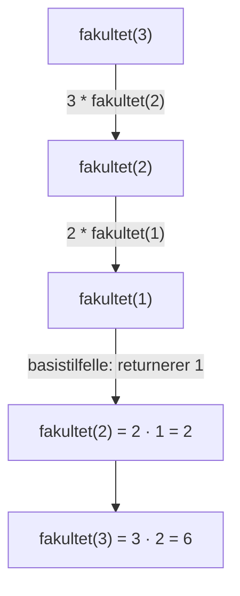

# Retningslinjer for illustrasjoner

## Innhold
1. Når en illustrasjon hjelper
2. Velg verktøy
3. Stilregler
4. Animasjoner for algoritmer og prosesser
5. Kontinuerlige fordelinger
6. Eksempler

## 1. Når en illustrasjon hjelper

Lag en illustrasjon når den viser noe som er tungt å holde i hodet fra tekst alene:

| Type | Eksempler | Passende form |
|---|---|---|
| Algoritme | sortering, søk, grafsøk (BFS/DFS), Dijkstra, dynamisk programmering | animasjon som kan spilles av steg for steg (se del 4) |
| Prosess / flyt | beslutningstre, kall-stakk ved rekursjon | flytskjema, trinnvise tilstander |
| Struktur | datastrukturer, minne, nettverk, mengder | bokser og piler, Venn-diagram |
| Fordelinger | sannsynlighetsfordelinger, histogrammer | stolpediagram (diskret), kurve med skravert areal (kontinuerlig, se del 5) |
| Geometri | derivert som stigning, integral som areal, vektorer | koordinatsystem med markerte elementer |
| Sammenligning | med/uten tilbakelegging, O(n) mot O(n²) | to figurer side om side på samme skala |

Ikke lag illustrasjon når teksten allerede er klar, når figuren bare gjentar en formel, eller når brukeren har bedt om et raskt svar. Én god figur er bedre enn tre middels.

## 2. Velg verktøy

Gå nedover listen og bruk det første som er tilgjengelig:

1. **Miljøets innebygde visualisering.** Har miljøet artifacts, inline-diagrammer, widgets eller et eget visualiseringsverktøy (som i Claude.ai), bruk det. Det gir best resultat for brukeren uten ekstra steg. Interaktivitet (f.eks. en glidebryter for parameteren λ) er verdt det når brukeren lærer mest av å se hva som skjer når noe endres.
2. **Selvstendig SVG- eller HTML-fil.** I Claude Code eller andre miljøer med filtilgang: skriv en `.svg` eller `.html`-fil uten eksterne avhengigheter, og si hvor den ligger og at den kan åpnes i nettleseren.
3. **Mermaid** for flytskjemaer, sekvensdiagrammer og tilstandsdiagrammer, når miljøet viser Mermaid eller brukeren kan lime det inn et sted som gjør det.
4. **ASCII** som siste utvei, i en kodeblokk. Hold det enkelt; ASCII egner seg for små stolpediagram, trær og tabeller, ikke for kurver.

## 3. Stilregler

- **Tydelige etiketter.** Navngi akser, enheter og alle viktige elementer direkte i figuren. Bruk de samme symbolene som i forklaringen (står det `k` i teksten, står det `k` på aksen).
- **Få farger.** Én nøytral farge for det meste og én fremhevingsfarge for det figuren handler om (f.eks. stolpen for P(X = 2)). Maks 3–4 farger totalt. Ikke la farge være eneste skille; bruk også etikett eller mønster.
- **Lesbart i lys og mørk modus.** I SVG/HTML: bruk `currentColor` for tekst og linjer, eller CSS-variabler med `@media (prefers-color-scheme: dark)`. Velg fremhevingsfarger med god kontrast mot både hvit og mørk bakgrunn (mellomtoner som `#3b82f6` eller `#e8590c`).
- **Ingen pynt.** Ingen 3D, skygger, gradienter, ikoner eller bakgrunnsbilder som ikke forklarer noe. Hvert element skal ha en jobb.
- **Tittel som sier poenget.** «Flest utfall rundt forventningsverdien 1,6» lærer mer bort enn «Fordeling».
- **Forklar figuren i teksten.** Si i én–to setninger hva brukeren skal legge merke til.

## 4. Animasjoner for algoritmer og prosesser

En algoritme er en serie tilstander. En animasjon lar brukeren se hver tilstand og hva som endret seg, i eget tempo. Lag en når temaet er en algoritme eller en prosess med mange like steg (sortering, binærsøk, BFS/DFS, Dijkstra, fylling av en DP-tabell, push/pop på en stakk).

Bruk [assets/animation-template.html](../assets/animation-template.html). Den har avspilling, steg frem og tilbake, fart, tastatur (mellomrom, piltaster), kodelinjen som kjøres markert, og en setning som forklarer hvert steg. Eksempelet i malen er boblesortering.

1. Kopier malen og fyll inn `ANIM`: tittel, `lang`, koden eller pseudokoden, og fargeforklaringen.
2. Skriv `buildSteps()` slik at den **kjører algoritmen på ekte** og tar et øyeblikksbilde per steg. Da blir stegene riktige, og du slipper å regne dem ut for hånd.
3. Gjelder det en liste (sortering, søk, to-pekere), behold `draw()`. For grafer, trær, rutenett eller stakker: skriv ny `draw()` med noder og kanter i SVG, og bruk de samme rollene (`active`, `swap`, `done`) eller legg til nye i CSS-en.
4. Bruk et lite eksempel (5–8 elementer, 5–7 noder). Det blir 15–40 steg, som er nok til å se mønsteret uten å kjede seg.
5. Hver `note` skal si hva som skjer *og hvorfor*, med de faktiske tallene: «Sammenlign 8 og 1. 8 > 1, så de bytter plass.»

Vis animasjonen som artifact der miljøet har det; ellers lagre den som `.html` og si at den kan åpnes i nettleseren. Spor også de 2–3 første stegene i teksten, så forklaringen gir mening uten animasjonen.

En animasjon passer ikke når tilstanden ikke endrer seg trinnvis (en formel, en definisjon), eller når det bare er 2–3 steg; da holder det med figurer side om side.

## 5. Kontinuerlige fordelinger

For normalfordeling, t-fordeling, eksponentialfordeling o.l. er sannsynlighet *areal under kurven*. Figuren skal vise det arealet.

- Tegn tetthetskurven og skraver arealet spørsmålet gjelder: P(X ≤ a), P(a < X < b) eller halene. Skriv sannsynligheten inne i eller ved arealet.
- Merk viktige punkter på x-aksen med begge skalaer når det handler om standardisering: `x = 180` over `z = 1,5`, og `μ` over `0`.
- For kvantiler: skraver arealet p og pek på grensen med «kvantilen = ?». Det viser at man går fra areal til verdi, motsatt vei av å finne en sannsynlighet.
- For lineærkombinasjoner (X + Y, X − Y, gjennomsnitt): tegn fordelingene på samme akse, så brukeren ser at forventningen flytter seg og at spredningen endrer seg.
- **Regn punktene med kode**, ikke tegn kurven på øyemål. I HTML: regn tettheten i JavaScript og tegn en `<path>`. I Python: matplotlib med `fill_between`.
- En glidebryter for μ og σ (eller for grensen a) er verdt det når poenget er hvordan arealet endrer seg.

## 6. Eksempler

### Eksempel A: Sannsynlighetsfordeling som stolpediagram (SVG)

Hypergeometrisk fordeling: trekk n = 4 kort fra en bunke med N = 10 kort, der K = 4 er røde. X = antall røde kort trukket. Stolpen for k = 2 er fremhevet fordi den er det mest sannsynlige utfallet.

```svg
<svg xmlns="http://www.w3.org/2000/svg" viewBox="0 0 360 230" font-family="system-ui, sans-serif" font-size="12">
  <style>
    .txt { fill: #1f2937; } .axis { stroke: #1f2937; }
    .bar { fill: #9ca3af; } .hi { fill: #3b82f6; }
    @media (prefers-color-scheme: dark) {
      .txt { fill: #e5e7eb; } .axis { stroke: #e5e7eb; } .bar { fill: #6b7280; }
    }
  </style>
  <text class="txt" x="180" y="18" text-anchor="middle" font-weight="600">Mest sannsynlig: 2 røde av 4 trukne</text>
  <line class="axis" x1="50" y1="190" x2="340" y2="190"/>
  <line class="axis" x1="50" y1="190" x2="50" y2="35"/>
  <!-- P(X=k) for k=0..4: 0.071, 0.381, 0.429, 0.114, 0.005; 1.0 = 300 px -->
  <rect class="bar" x="65"  y="169" width="40" height="21"/>
  <rect class="bar" x="120" y="76"  width="40" height="114"/>
  <rect class="hi"  x="175" y="61"  width="40" height="129"/>
  <rect class="bar" x="230" y="156" width="40" height="34"/>
  <rect class="bar" x="285" y="188" width="40" height="2"/>
  <g class="txt" text-anchor="middle">
    <text x="85" y="164">0,07</text><text x="140" y="71">0,38</text>
    <text x="195" y="56">0,43</text><text x="250" y="151">0,11</text><text x="305" y="183">0,005</text>
    <text x="85" y="205">0</text><text x="140" y="205">1</text><text x="195" y="205">2</text>
    <text x="250" y="205">3</text><text x="305" y="205">4</text>
    <text x="195" y="224">k = antall røde kort trukket</text>
  </g>
  <text class="txt" x="16" y="115" text-anchor="middle" transform="rotate(-90 16 115)">P(X = k)</text>
</svg>
```

Hvorfor den fungerer: aksene bruker de samme symbolene som formelen, verdiene står på stolpene så brukeren slipper å lese av skalaen, og én farge viser poenget.

### Eksempel B: Rekursjon som flytskjema (Mermaid)



Hvorfor den fungerer: den viser både veien ned (kallene) og veien opp (returverdiene), som er akkurat det som er vanskelig med rekursjon.

### Eksempel C: Sammenligning i ASCII (siste utvei)

Med og uten tilbakelegging, 2 trekk fra en pose med 3 røde (R) og 2 blå (B):

```
Med tilbakelegging            Uten tilbakelegging
Trekk 1: R R R B B            Trekk 1: R R R B B
         ↓ legg tilbake                ↓ trukket R tas ut
Trekk 2: R R R B B            Trekk 2: R R B B
P(R) = 3/5 begge ganger       P(R) = 3/5, så 2/4
→ binomisk fordeling          → hypergeometrisk fordeling
```

Hvorfor den fungerer: to tilstander side om side gjør forskjellen synlig uten tekst rundt.
